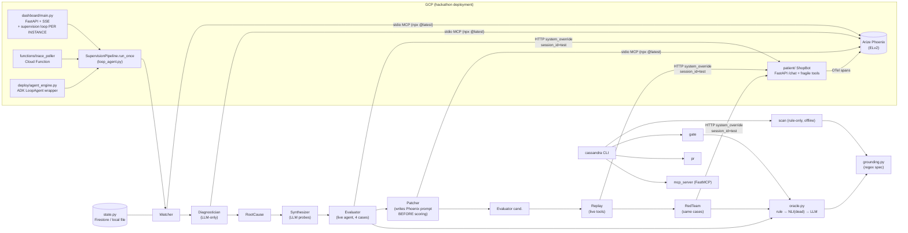
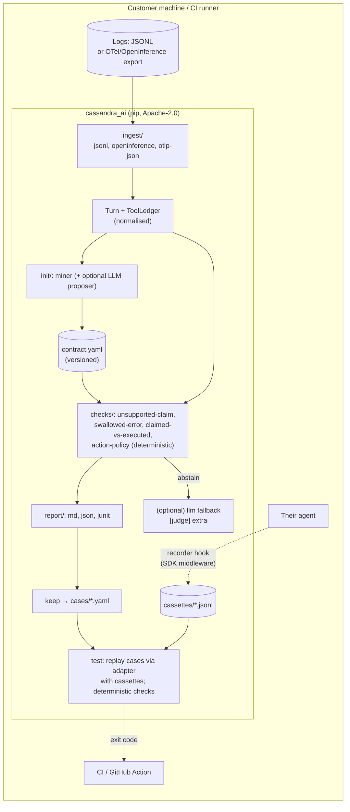
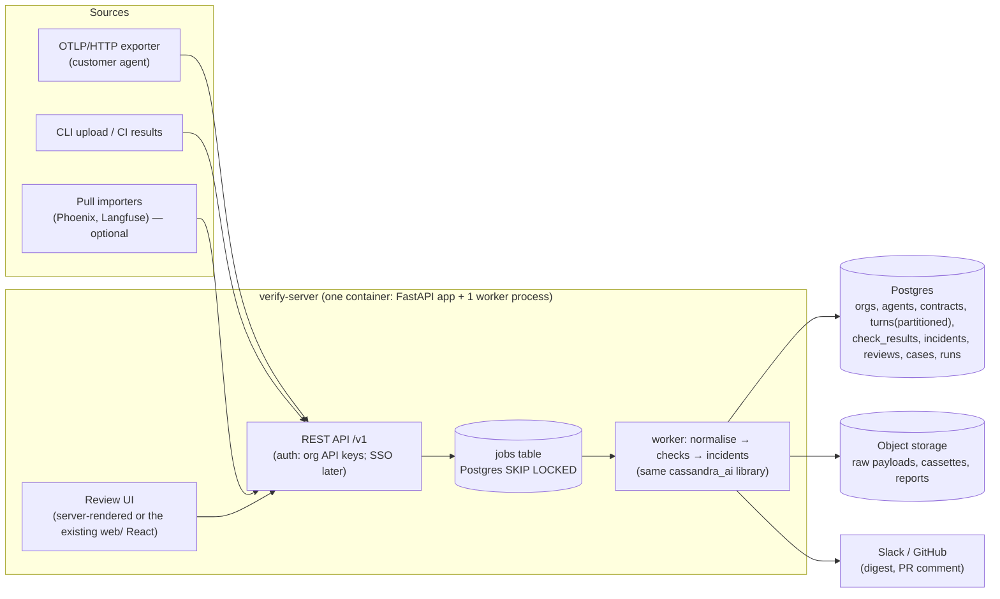

# Architecture evolution: from hackathon pipeline to product (2026-11-05)

> Part of the strategy set. Master document: [PRODUCT_VISION_AND_COMPANY_ROADMAP.md](PRODUCT_VISION_AND_COMPANY_ROADMAP.md)
> (§10 holds the full technical-debt register, §11 security).
> Code references are to `feature/nli-and-hindi` @ `23994bf` unless noted.

## 1. Current architecture (as built)

**What it makes easy:**

- adding a pipeline stage (one `Incident` threaded through);
- swapping LLM backends (`llm.py`);
- unit-testing logic without cloud (116 offline tests);
- running `scan` anywhere (7 dependencies).

**What it makes hard:**

- **Using it on a real agent safely.** Live replay executes real tools, and the override endpoint fails open.
- **Running more than one instance.** The loop runs per instance; state is not concurrency-safe.
- **Leaving Phoenix.** The Watcher, Diagnostician and Patcher talk to Phoenix through MCP stdio.
- **Trusting any number.** The verifier has holes, eval denominators are wrong, and pass rates move in 25% steps.
- **Onboarding a stranger.** Contracts are hand-written regex.

## 2. Keep, refactor, replace

| Component | Decision | Reason |
|---|---|---|
| `models.py` (`Incident`, `Verdict`, `FailureClass`), Pydantic everywhere | **Keep** | Clean, typed spine |
| `grounding.py` concept (declarative per-agent spec, rule-first, abstain-don't-guess, cite the call) | **Keep the concept; rewrite the evaluator** as `checks/` over Contract v1 (value matching, all matches, decline-per-claim, argument-aware call matching) | The idea is the differentiator; the implementation is under-specified (master §10, TD-01..04) |
| `scan.py` | **Keep; generalise** to run any check set and emit JSON + Markdown + JUnit | Already the best entry point |
| `oracle.py` cascade | **Keep; simplify**: rule → (optional) LLM. Park NLI | NLI has no production caller |
| `llm.py` backend selection + Vertex retry | **Keep** (optional extra) | Works; needed only for `--judge`, `init --propose`, fix proposals |
| `config.py` (cached Settings) | **Keep; fix** `load_dotenv(override=True)` → `override=False`; CLI flags win over env | Security finding |
| `gate.py` | **Refactor** into `test` over kept cases + cassettes | Live, LLM-scored gate is flaky and has side effects |
| `patcher.py`, `rootcause.py` | **Refactor later** (P2): quote traffic as data, patch from clusters, score before persisting | Injection-prone; persisted before scoring |
| `synthesizer.py`, `redteam.py`, `evaluator.py` | **Freeze**. Replace with kept real cases + "normal traffic" cases | Synthetic probes reward refusal; red-team overlaps the eval set; denominator bug |
| `watcher.py`, `state.py`, `loop_agent.py`, `phoenix_mcp.py` | **Freeze in place** as the demo pipeline; rebuild continuous verification on the server (Phase 5) with idempotent ingestion | Data-loss races; Phoenix-coupled; not a CLI concern |
| `patient/` (ShopBot) | **Move out of the wheel** to `examples/shopbot/` | Generic top-level package name shipped on PyPI |
| `dashboard/`, `web/`, `dashboard/ui/` | **Move out of the wheel**; keep the React app only as the marketing site | Not a product surface for the CLI phase |
| `deploy/agent_engine.py`, `functions/trace_poller`, ADK wrapper | **Archive** to `examples/` | Hackathon envelope; `LoopAgent` deprecated in google-adk 2.13 |
| `nli.py`, `jury.py`, `selfeval.py`, `traps.py` | **Keep, dormant** (not in the default install path, not in the roadmap) | No caller / no customer. The jury's temperature-only diversity is a weak panel (review `de88f46`) |
| `mcp_server.py` | **Keep, pin** `mcp<2`; don't extend | Broken on fresh install |
| `pr.py` | **Keep; fix** the branch fallback | Useful later |

## 3. Target architecture

### 3.1 Now → Phase 4 (OSS CLI + library; no server)

The simplest thing that can win the first 100 users is **one Python package, no service**.

Component responsibilities:

| Module | Responsibility | Boundary contract |
|---|---|---|
| `ingest/` | Turn any supported log format into `Turn{id, conversation[], answer, ledger[]}` | **Turn JSONL schema v1** (public, versioned) |
| `contract/` | Load, validate, lint and migrate contracts. Includes the `GroundingSpec` → v1 migration | **Contract schema v1** (public, JSON Schema published) |
| `init/` | Deterministic mining. Optional LLM proposal behind `[propose]` | Emits contract v1 + coverage summary |
| `checks/` | Pure functions `(Turn, Contract) → [CheckResult]`. No I/O, no LLM | **CheckResult schema** (`check_id, status, claim, evidence{call_index, field, expected, actual}, rationale`) |
| `report/` | Render results | md/json/junit |
| `cases/` + `replay/` | Regression case = conversation prefix + cassette + assertions. Replay drives the agent through the **adapter contract v2** | Adapter contract v2 (below) |
| `llm/` (extra) | Only for `--judge`, `--propose`, and fix proposals | Existing `llm.py` |

**Adapter contract v2.** This replaces the fail-open `system_override`. The agent exposes `/chat`. Replay
calls it with a header `X-Verify-Replay: <signed token>` and a body
`{message, history, prompt_override?, cassette_id}`. In replay mode the agent's tool layer must serve
responses from the cassette **and refuse to call real tools**.

- The token is an HMAC over the body with a shared secret.
- The default is **deny**: no secret configured means replay mode is unavailable.
- For Python agents the recorder/replayer is a decorator around tool functions, so most teams never write
  an adapter. For other agents, the HTTP contract is documented with a conformance test (`cassandra adapter check URL`).

### 3.2 Phase 5–6 (first paying teams): one server, one database, one worker

**Avoid microservices.** A single deployable serves both hosted and self-hosted customers.

Design rules:

- **The worker runs the same `cassandra_ai` library** as the CLI. One verdict engine, so CLI and server
  results never disagree.
- **Idempotent ingestion** keyed on `(org_id, trace_id, span_id)`. No cursors, so the Watcher's
  burst-loss and empty-poll bugs disappear by construction.
- One worker process with Postgres job leasing (`FOR UPDATE SKIP LOCKED`). Scale by adding worker
  processes, not services.
- PII redaction runs **before** persistence (configurable patterns + optional detector). Raw payload
  retention is configurable down to zero: keep only the evidence fields.
- Multi-tenancy: `org_id` on every row + Postgres row-level security. Self-hosted = the same image, one org.

### 3.3 Core database entities (server)

| Entity | Key fields | Notes |
|---|---|---|
| `org` | id, name, plan, data_retention_days | tenant |
| `agent` | id, org_id, name, framework, environment | one org, many agents; pricing unit |
| `contract` | id, agent_id, version, body(jsonb), created_by, active | immutable versions |
| `turn` | id, agent_id, trace_id, span_id, ts, conversation(redacted), ledger(jsonb) | partitioned by month |
| `check_result` | id, turn_id, contract_version, check_id, status, evidence(jsonb), layer(rule/llm) | append-only |
| `incident` | id, agent_id, cluster_key, first_seen, last_seen, count, status | groups check_results |
| `review` | id, check_result_id, reviewer, label(confirmed/dismissed/unsure), note | feeds precision + the golden corpus |
| `case` | id, agent_id, source_turn_id, cassette_ref, assertions(jsonb) | regression suite |
| `run` | id, agent_id, trigger(ci/manual), prompt_hash, model, results(jsonb), passed | CI history |
| `fix_proposal` | id, incident_id, diff, eval_delta(jsonb), pr_url, status | human-approved only |
| `audit_event` | id, org_id, actor, action, target, ts | enterprise |

### 3.4 What changes at 10k and 100k users (don't build it now)

| Concern | ≤ 1k users (Phase 5) | ~10k users | ~100k users |
|---|---|---|---|
| Turn volume | Postgres partitions | Move turns/check_results to a columnar store (ClickHouse) for analytics; Postgres keeps reviews/incidents/cases | Tiered storage; sampling policies per agent |
| Ingestion | API → jobs table | Queue (SQS/Redis Streams) in front of workers | Regional ingest endpoints |
| Workers | 1–3 processes | Autoscaled worker pool | Per-tenant fairness / quotas |
| LLM fallback | Customer's own key | Our pooled keys + caching of identical undecided turns | Distilled small judge (F-29), batch inference |
| Tenancy | RLS | RLS + per-tenant encryption keys for enterprise | Dedicated cells for large tenants |
| DR | Daily Postgres backups, 7-day PITR | Cross-region replicas | Multi-region active/passive |

### 3.5 Integration boundaries (what we depend on, and how loosely)

| Dependency | Boundary | Coupling rule |
|---|---|---|
| Trace platforms (Phoenix, Langfuse, LangSmith, Datadog) | File importers and optional pull adapters | Never required. Never on the verdict path |
| OTel GenAI conventions | `ingest/otlp` maps `gen_ai.*` + `execute_tool` spans | Tolerate drift: conventions are "Development" status |
| LLM providers | `llm/` behind an extra; BYO key | Verdicts never depend on an LLM unless labelled `layer=llm` |
| GitHub | Action + PR comment + `pr` | Optional |
| GCP (Vertex, Firestore, Cloud Run, Agent Engine) | Examples only | Out of core |

## 4. Migration sequence (dependency order)

1. Package hygiene: rename to `cassandra_ai`, move `patient/` + `dashboard/` out of the wheel, pin `mcp<2`,
   add CI. Small, and unblocks everything.
2. Contract v1 + `checks/` (value-matched unsupported-claim, swallowed-error) behind the existing `scan` CLI,
   with a golden corpus and per-check precision in CI.
3. `init` + backtest.
4. `keep` + cassettes + `test` (adapter contract v2 with a Python decorator recorder first).
5. Freeze the GCP pipeline; move it to `examples/`.
6. Server (Phase 5), reusing the library.

Each step ships on its own and is independently useful. No step requires a rewrite of a working component.
