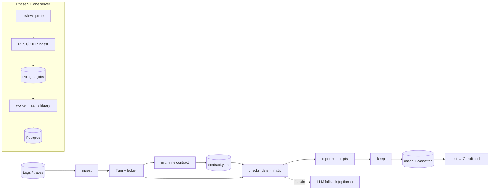

# Cassandra: product vision and company roadmap

> **Date:** 2026-11-05 · **Status:** strategy proposal for the founders. Nothing here has been executed. No
> application code, branch or history was changed while producing it.
>
> **Document set** (read this one first):
>
> | Document | Contents |
> |---|---|
> | [BRANCH_AUDIT.md](BRANCH_AUDIT.md) | Every branch: lineage, unique work, verified defects, consolidation plan |
> | [COMPETITIVE_ANALYSIS.md](COMPETITIVE_ANALYSIS.md) | 2026 landscape with sources and verification levels |
> | [PRODUCT_REQUIREMENTS.md](PRODUCT_REQUIREMENTS.md) | Feature map (42 features in 8 categories), interface decision, non-goals |
> | [ARCHITECTURE_EVOLUTION.md](ARCHITECTURE_EVOLUTION.md) | Current vs target architecture, entities, scale stages, migration order |
> | [GO_TO_MARKET.md](GO_TO_MARKET.md) | Messaging, what to publish, channels for 100 / 1k / 10k users |
> | [ENGINEERING_BACKLOG.md](ENGINEERING_BACKLOG.md) | ~50 implementable tasks with IDs, acceptance criteria, critical path |
>
> **Fact / assumption / hypothesis.** Statements marked *(measured)* were run or reproduced during this
> audit. *(Repo)* means recorded in the repository by the team. *(Source)* means external, cited in
> COMPETITIVE_ANALYSIS. *(Hypothesis)* means untested. Everything else is reasoning.

---

## 1. Executive summary

**What exists.** Cassandra is a well-engineered hackathon project that has turned into two half-products:

- A Phoenix-coupled "meta-agent" pipeline that watches an agent's traces, diagnoses failures, writes a
  prompt patch, and replays it. This is the demo.
- A small offline CLI, `cassandra scan`, that checks exported chat logs for answers stating facts that no
  tool call returned. This is the product seed. It went to PyPI as `cassandra-ai 0.3.0` today.

The code has clean seams and 116 offline tests. It has no users, no CI, and zero customer conversations
recorded (*repo*: the `OUTREACH.md` tracker is empty).

**What the evidence says.** The team did something rare: it tried to falsify its own thesis. On 1,980 real
agent trajectories (tau-bench), agents essentially never fabricate values. A value-grounding alarm barely
beats guessing (44.8% precision against a 40.3% base rate) (*measured: reproduced exactly in this audit*).
On the team's own honest test agent (TravelPal: narrow tools, open questions), 14–30% of answers did state
unbacked facts, and the rule-first detector caught them with 100% precision on held-out turns (*repo*).

Both results are real. They describe different agent shapes. One conclusion holds across all the evidence,
including an independent ICML 2026 paper: **LLM-as-judge is not a usable production alarm** (37–53% precision
here; AUROC ≤ 0.65 in the paper). **Deterministic, domain-calibrated checks are far more precise.** A new
probe in this audit found a cheap check, "write tool errored, then the agent claimed success", at 80.4%
precision. It also found that **94.6% of failed transactional-agent trajectories did the wrong
state-changing action**, a failure no text check sees.

**The problem with the company today:**

1. The two founders' lines of work have diverged. The evidence that undercuts the current positioning
   lives on a branch the product line never received.
2. The shipped package collides with the `cassandra-driver` import name. It is also broken on fresh
   `[full]` installs (`mcp` 2.x), and "Cassandra" is an Apache Software Foundation trademark.
3. The integration a real customer would copy (the adapter template) fails open on a
   "replace my system prompt" endpoint. Replay executes real tools.
4. Incumbents (Braintrust Loop, LangSmith Insights, Galileo, Patronus Percival, Raindrop, Arize Alyx) already
   sell "find agent failures → suggest a fix" inside platforms teams already pay for.

**Recommendation (single strongest direction).** Build **a local-first, deterministic verifier for
tool-using agents**. It checks what the agent *said and did* against what its tools *returned* and the
team's rules *allow*, cites the receipt for every flag, and turns confirmed failures into **replayable
regression tests** (recorded tool responses, no live side effects) that gate prompt, model and tool changes
in CI.

- **Open-source CLI first.** The commercial product is a self-hostable server for continuous verification,
  review and audit export, aimed at teams whose agents take consequential actions (support with
  refunds/cancellations, fintech, insurance, travel).
- **Not "Sentry for agents", not "hallucination detection", not "self-healing".**
- **Spend the next 30 days proving that real teams' logs contain failures these checks catch, and that
  the teams care.** Build only what makes those reports trustworthy and the onboarding automatic.

**Overall startup potential today: 4/10** (§20). It's a credible wedge with unusually honest technical
foundations, but no demand signal yet, a crowded and consolidating market, and part-time founders. It can
move to 6–7/10 within 60 days if experiments E1–E3 (§15) succeed.

---

## 2. Repository and branch intelligence report

Full detail: [BRANCH_AUDIT.md](BRANCH_AUDIT.md).

**Inventory:**

- 8 remote branches + a stale local `main`.
- Default branch `main` @ `09ef23e` (2026-08-11) is a hackathon-end snapshot plus a market-sizing doc.
- Tag `v0.2.0-alpha.1` on the shared trunk.

| Line | Branches (tip) | What it contains | Test status (*measured*, Python 3.13 fresh venv) |
|---|---|---|---|
| Shared trunk | `62790b4` (2026-07-21) | Grounding verifier, oracle swap, CLI, PyPI packaging, hmac fix | — |
| **Sirjan's line** | `cassandra-v2` ⊂ `task0-grounding-base-rate` (`1694ebb`, 2026-09-25) | **Evidence and audits only**: code audit, security audit (3 CRITICAL / 4 HIGH), stress harness, Task 0 falsification | 73 passed |
| **Kshitij's line** | `multi-agent-v1` ⊂ `demo/mock-bot-integration` ⊂ **`feature/nli-and-hindi`** (`23994bf`, today) | **All product work**: jury, PR flow, HTML demo, NLI, Hindi, TravelPal PoC, `scan`, outreach kit, PyPI 0.3.0 | 116 passed **only with `mcp<2`**. Out of the box: 1 collection error + 1 failure |
| Merged | `feature/ci-prompt-gate`, `feature/incident-postmortems` | Merged June 10 | — |

**Strongest foundation:** `feature/nli-and-hindi` (code). **Strongest evidence:** `task0-grounding-base-rate`.
The best product combines the two. Neither contains the other, and they disagree about what to sell.
Consolidation plan: BRANCH_AUDIT §6. Backlog: CON-1..4.

---

## 3. Current-state technical assessment

### 3.1 What it does today

| Capability | Status | Where |
|---|---|---|
| Offline scan of JSONL chat logs with a per-agent regex "grounding spec"; markdown/JSON report; optional LLM for undecided turns | ✅ works (with verifier defects below) | `cassandra/scan.py`, `grounding.py` |
| Light install: `pip install cassandra-ai`, 7 dependencies | ✅ on PyPI since today. ⚠️ namespace collision | `pyproject.toml` |
| 8-stage supervision pipeline over Phoenix (watch → diagnose → root-cause → synthesize → eval → patch → replay → red-team → postmortem) | 🧪 demo-grade; correctness and safety defects | `loop_agent.py` and stage modules |
| CI prompt gate (live agent, rule → LLM scoring) | ⚠️ works for read-only agents; flaky; side effects for write tools | `gate.py` |
| Open a proven fix as a GitHub PR (human-gated) | ✅ minor branch bug | `pr.py` |
| MCP server (diagnose, synthesize, propose patch, gate, …) | ⚠️ broken on fresh install (`mcp` 2.x) | `mcp_server.py` |
| Multi-judge jury, NLI layer, Hindi support | ✅ code + tests; **NLI has no production caller**; jury diversity is temperature-only | `jury.py`, `nli.py` |
| Self-evaluation against 11 hand-labelled traps | 🧪 tiny set, ShopBot-specific | `selfeval.py`, `traps.py` |
| ShopBot demo agent, React cockpit, HTML playground, GCP deploy (VM, Cloud Run, Agent Engine) | 🧪 hackathon assets | `patient/`, `web/`, `demo/`, `deploy/` |
| TravelPal proof of concept: 148 hand-labelled turns, real fix loop | ✅ the best evidence artefact | `poc/travelpal/` |

Size (*measured*):

- `cassandra/`: 34 modules, 4,324 LOC.
- Tests: 19 files, 1,873 LOC, 116 tests, all offline (LLM and MCP mocked).
- `web/src`: about 1.1k LOC.
- 51 Markdown files under `docs/` on the product line, including 22 session notes.

### 3.2 Problem, user, workflow (as the repo intends them)

- **Problem:** tool-using agents state or do wrong things confidently, and nothing errors.
- **Intended user** (*repo*, `POSITIONING.md`): teams running tool-using agents where a confidently wrong
  specific costs money: fintech, insurance, health, travel, logistics, regulated support.
- **Intended workflow** (*repo*): (1) scan exported logs → (2) expose a `/chat` endpoint so Cassandra can
  replay and measure prompt fixes → (3) CI gate + fix PRs.

### 3.3 What is genuinely differentiated

1. **Verdicts by rule over the tool ledger, citing the exact call**, with the LLM demoted to a fallback.
   This is the idea worth building a company on (§6). It is also, as built, under-specified (§3.5).
2. **Local-first and offline by default.** `scan` needs no platform, no account and no LLM.
3. **A measurement culture.** Labels were written before verdicts. There is a held-out set, reproducible
   scripts, and negative results reported. Competitors' "accuracy" claims are mostly self-reported. This
   discipline is itself a GTM asset (GO_TO_MARKET §3).

What is **not** differentiated: tracing, dashboards, LLM-judge diagnosis, prompt-patch proposals, a CI eval
gate, a PR bot. Incumbents ship all of them (COMPETITIVE_ANALYSIS §2).

### 3.4 What is incomplete (proposed, not built)

- Contract mining (`spec init`). Designed in the 2026-08-05 note §4; not started. **This is the adoption blocker.**
- Typed claim extraction (replacing hand regex).
- Record/replay of tool responses.
- A regression set of normal traffic (so "refuse everything" stops being the optimum).
- An incident store, review workflow, auth, any server.
- Telemetry independence (OTel/OpenInference file ingest).
- A docs site and quickstart with sample data.
- CI.

### 3.5 What is broken

All verified in code today (BRANCH_AUDIT §5):

- **Verdicts:**
  - field claims are tested for non-null, never equality;
  - any successful call grounds any claim;
  - first match only;
  - declines are unreachable once a claim matches;
  - the live detection path is LLM-only.
- **Metrics:**
  - eval errors leave the denominator;
  - 4-case pass rates;
  - red-team reuses the eval set.
- **Pipeline:**
  - burst incidents are silently dropped;
  - the cursor jumps to `now`;
  - state isn't concurrency-safe.
- **Safety:**
  - replay runs real tools;
  - the override fails open (Patient **and** adapter template);
  - traffic flows into the patcher unquoted, and the patch is persisted before it is scored.
- **Packaging:**
  - top-level `cassandra`/`patient`/`dashboard` on PyPI;
  - `mcp` 2.x breaks `[full]`;
  - floor-only dependencies;
  - unpinned ruff (49 findings with today's ruff).

### 3.6 What the architecture makes easy, and what it makes hard

- **Easy:**
  - pure, unit-testable logic;
  - one `Incident` spine;
  - swappable LLM backends;
  - a tiny dependency footprint for `scan`;
  - adding a check as a pure function.
- **Hard:**
  - safe use on agents with write tools;
  - running more than one instance;
  - leaving Phoenix (Watcher, Diagnostician and Patcher talk to it via MCP stdio);
  - trusting any number;
  - onboarding a stranger.

Details and the keep/refactor/replace table: ARCHITECTURE_EVOLUTION §1–2.

---

## 4. Product opportunity analysis

Seven directions were evaluated, including ones that drop the original idea entirely.

- **D1, grounding monitor.** The current `POSITIONING.md`: "catch facts no tool gave".
- **D2, deterministic action-and-claim verification.** Unsupported claims (value-matched), swallowed
  errors, claimed-vs-executed actions, action-policy preconditions, all from one per-agent contract.
- **D3, agent regression testing with record/replay.** Production failures → cassette-backed CI tests.
- **D4, autonomous remediation.** The hackathon pitch: detect → patch → verify → PR.
- **D5, productised "agent failure audit" service.** For regulated teams before or after launch.
- **D6, Phoenix/Arize ecosystem add-on.** The 2026-08-05 launch plan's shape.
- **D7, in-path runtime guard.** Block a policy-violating write call before it executes.

| Dimension | D1 Grounding | **D2 Verification** | D3 Replay regression | D4 Self-healing | D5 Audit service | D6 Phoenix add-on | D7 Runtime guard |
|---|---|---|---|---|---|---|---|
| Problem severity | Medium for narrow-tool assistants. Low for well-tooled agents (Task 0) | **High** for transactional agents: 94.6% of tau-bench failures were wrong writes (*measured*) | Medium–high: agent tests are flaky and replay has side effects | Medium: prompt fixes help only the detectable class (TravelPal) | High pre-launch for regulated teams | = D1/D2, Phoenix users only | High, if precise |
| Target audience | Q&A assistants with narrow tools | Agents that take consequential actions | Every agent engineering team | Platform users | Regulated enterprises, agencies | Phoenix/AX users | Same as D2, later |
| Existing alternatives | Galileo Luna, Patronus, Cleanlab TLM, Datadog hallucination eval, DIY scorers | DIY code scorers; Invariant/Snyk (security policies); research evals | Braintrust, LangSmith, Promptfoo, DeepEval in CI; pytest-agentreplay | Braintrust Loop, Arize Alyx, Patronus Percival, Galileo Insights | Consultancies, vendor solutions engineers | Arize's own evals + Alyx | NeMo Guardrails, Guardrails AI, Galileo Protect, Snyk |
| Market demand | Unvalidated, contested by own data | Unvalidated. Supported by benchmark failure anatomy + arXiv 2606.09863 | Evidenced by CI-eval tool adoption | Evidenced by incumbents shipping it | Unvalidated | Small | Evidenced by the guardrail category |
| Differentiation | Medium (receipts) but narrow | **High *if* contracts are mined automatically**: deterministic, auditable verdicts on *actions* | Medium (cassettes uncommon) | Low | Low | Low | Medium |
| Technical feasibility | High (exists, needs fixes) | Medium (claim extraction, mined contracts, policy DSL) | High | Medium; unsafe; degenerate optimum | High | High | Medium–low (latency, reliability, blast radius) |
| Monetisation | Low–medium | **Medium–high**: per agent, value pricing for regulated buyers, audit export | Low–medium (CI tools monetise poorly alone) | Low (bundled by incumbents) | Medium now, doesn't scale | Low; ELv2 blocks hosting | Medium–high (enterprise) |
| Distribution | Medium | Medium (needs proof; research post helps) | **High** (CLI, GitHub Action) | Low | Low | Medium, but one vendor's channel | Low early (needs trust) |
| Defensibility | Low | Medium: contract-mining corpus, vertical packs, neutrality | Low–medium | Low | Low | Very low | Medium |
| Time to MVP | 2–3 weeks (fixes) | 6–10 weeks | 4–6 weeks | Exists as a demo | Now | 2 weeks | 3–6 months |

**Ranking:**

| Rank | Direction | Verdict |
|---|---|---|
| **1** | **D2 verification** | **The product identity.** It's where the evidence points and where differentiation is real. D1 becomes one of its checks. |
| **2** | **D3 replay regression** | **The retention workflow.** It also fixes the replay-side-effect blocker. Ships inside the same CLI. |
| 3 | D5 audit service | **The first revenue motion**, not the company: concierge reports teach `init` what to automate. |
| 4 | D1 grounding | Keep as a check. Don't lead with it. |
| 5 | D7 runtime guard | A natural year-2 extension of D2's contracts, once post-hoc precision is proven. |
| 6 | D6 Phoenix add-on | A distribution channel and importer, not an architecture. ELv2, a single vendor, and Arize can build it. |
| 7 | D4 self-healing | Drop as a pitch. Incumbents own it, it's injection-prone, and "refuse everything" games it. Keep fix proposals as a minor, human-approved feature. |

Brutal note: **D1 as the company, the current positioning, ranks 4th.** The team's own most rigorous data
argues against leading with it, and that data hasn't reached the person running outreach.

---

## 5. Competitive landscape

Full analysis with sources: [COMPETITIVE_ANALYSIS.md](COMPETITIVE_ANALYSIS.md).

2026 moves that matter:

- ClickHouse acquired Langfuse (Jan).
- OpenAI announced the Promptfoo acquisition (Mar).
- Snyk acquired Invariant Labs (Jun 2025).
- Raindrop raised a $15M seed as "Sentry for AI agents".
- Sentry ships agent monitoring free.
- Braintrust Pro is listed at $249/month (*source, primary*), with Loop iterating on prompts automatically.
- LangSmith Plus is $39/seat with an Insights agent.

The platform layer is consolidating and its prices are compressing.

**Why would a developer switch?** They wouldn't. They'd **add** Cassandra next to their tracer, if three
things are true:

1. Flags are precise enough to act on without a second look ("alerts with receipts").
2. It runs in five minutes on their laptop with nothing leaving.
3. Failures become flake-free CI tests.

Only (2) is true today. (1) and (3) are the MVP.

**Copyable in 6–12 months:** deterministic scorers, fix loops, CI gates.

**Harder to copy:**

- contract-mining quality, built on a corpus of real traces and labels;
- neutrality, since platform and model vendors grade their own;
- vertical check packs.

---

## 6. Recommended product positioning

- **Category:** agent verification. Deterministic testing and monitoring for tool-using AI agents.
- **One sentence:** *Cassandra checks what your AI agent said and did against what its tools returned and
  what your rules allow, cites the receipt for every flag, and turns each confirmed failure into a
  replayable regression test.*
- **Product philosophy:**
  1. **The verdict is code; models only extract.** No unexplained flags.
  2. **Abstain rather than guess.** Coverage is reported honestly.
  3. **Local-first.** It runs where the data is.
  4. **Humans approve every change.** No autonomous production edits.
  5. **Every number names its sample.**
- **Core differentiator:** precision with evidence, on actions as well as words, at near-zero setup cost via
  mined contracts.
- **What we deliberately won't build:**
  - tracing, dashboards, cost and latency analytics;
  - a general answer-quality grader;
  - autonomous prompt deployment;
  - hosted Phoenix;
  - fine-tuned onboarding models;
  - more demo agents or languages;
  - an IDE or desktop app.

  (PRODUCT_REQUIREMENTS §3.)
- **Why developers should love it:**
  - `pip install` and a report in five minutes on their own logs;
  - every flag explainable with one command;
  - tests that don't flake or touch production;
  - it fits the tools they already use.
- **Why teams should pay:**
  - continuous verification across agents;
  - a review workflow that turns flags into a measured precision number;
  - history and audit export for compliance;
  - self-hosting, SSO;
  - vertical check packs;
  - someone accountable for the verifier being right.
- **Naming.** "Cassandra" is a trademark of the Apache Software Foundation (*source, primary*: the
  cassandra.apache.org footer lists "Cassandra" among ASF trademarks). It is also the most-searched database
  name in the developer world, and its Python import name is taken. **Rename the product before public
  launch.** Get a trademark lawyer's view before spending on it. The 2026-08-05 shortlist (Assay, Fiducial,
  Probity, Touchstone…) is a fine starting point; "Assay" fits the "the verdict is a test, not an opinion"
  philosophy best.

---

## 7. Ideal customer profile

**Company:**

- 10–500 people (startup to mid-market).
- One or more **customer- or operator-facing agents in production or late pilot** that **call tools that
  change state**: refunds, cancellations, bookings, account changes, claims, ticket actions.
- Where a wrong action has a money, compliance or trust cost.
- Verticals in priority order: e-commerce/marketplace support, fintech and lending ops, insurance
  claims/servicing, travel, B2B SaaS support automation.
- Disqualifiers:
  - pure RAG Q&A with no tools (incumbents are fine for them);
  - creative or open-ended assistants;
  - teams without logs.

**Team signals:**

- They already trace (Phoenix, Langfuse, LangSmith, Datadog, Sentry).
- They have had at least one incident where the agent "said it did X".
- They edit prompts weekly.
- They have CI.

**Primary persona: "the engineer on call for the agent."** A senior or staff engineer or ML engineer who owns
an agent in production.

- Their pain: LLM-judge evals are noisy; they can't tell which flagged conversations matter; prompt
  changes regress things they find out about from customers; they can't safely rerun a production failure.
- Success for them: fewer customer-found incidents and confident prompt and model upgrades.
- They don't sign POs. Their head of AI/ML or the platform lead does. In fintech and insurance, a
  compliance reviewer gates purchase.

These are hypotheses. E1–E3 (§15) test whether this persona exists in numbers and feels the pain.

---

## 8. Product requirements and feature roadmap

Full feature map: [PRODUCT_REQUIREMENTS.md](PRODUCT_REQUIREMENTS.md).

**The primary workflow:**

`init` (mine a contract from logs) → `scan` (deterministic checks with receipts) → `explain` → `keep`
(failure → case + cassette) → `test` (replay offline, gate CI)

| Horizon | Features (IDs) | Why now |
|---|---|---|
| **Now (MVP, ≤ 8 weeks)** | Clean package (F-17); Contract v1 (F-03); value-matched unsupported-claim (F-05); swallowed-error (F-06); golden corpus + published precision (F-30); `init` + backtest (F-10, F-11); quickstart (F-20); CI matrix (F-22) | Makes partner reports trustworthy and onboarding automatic |
| **Next (alpha, weeks 6–14)** | Cassettes (F-13); `keep` (F-12); `test` + GitHub Action (F-14, F-36); claimed-vs-executed (F-08); one framework recorder (F-35); OpenInference importer (F-02); lint/explain (F-19); redaction (F-33, CLI part) | The retention loop; safe replay |
| **Later (beta/commercial)** | Action policies (F-07, gated on evidence); review queue (F-23); server + self-host (F-28, F-31); Slack/GitHub digests (F-25); clustering (F-27); fix proposals done safely (F-15) | What teams pay for |
| **Year 2+** | SSO/RBAC, audit export (F-32, F-34); vertical packs (F-40); in-path guard (F-39); distilled judge (F-29); cross-customer taxonomy (F-41) | Enterprise and moat |

**Interface:** CLI + Python library first. Then GitHub Action. Then the server's web UI. No IDE or desktop app.

---

## 9. Target architecture

Full design: [ARCHITECTURE_EVOLUTION.md](ARCHITECTURE_EVOLUTION.md).

**Now (no server).** One Python package, `cassandra_ai`, with pure modules:

- `ingest/`: JSONL, OpenInference, OTLP-JSON → `Turn` + `ToolLedger`
- `contract/`: schema v1, lint, migration from `GroundingSpec`
- `init/`: deterministic miner + optional LLM proposer
- `checks/`: pure functions, the only place a verdict is decided
- `report/`
- `cases/` + `replay/`: cassettes + adapter contract v2, default-deny, HMAC

The LLM is an optional extra used only for undecided turns, contract proposals and fix proposals.

**First paying teams.** One container (FastAPI + one worker) + Postgres + object storage.

- Idempotent ingestion keyed on `(org, trace, span)` removes the Watcher's cursor bugs by construction.
- The worker imports the same library, so the CLI and server can't disagree.
- Redaction runs before persistence.
- Tenancy is row-level security.
- The same image serves hosted and self-hosted.

**Avoid:** microservices, Kafka, Kubernetes operators, and a bespoke trace store. Not until roughly 10k
users (ARCHITECTURE_EVOLUTION §3.4).

Core entities (server): `org`, `agent`, `contract` (versioned), `turn` (partitioned), `check_result`,
`incident`, `review`, `case`, `run`, `fix_proposal`, `audit_event` (ARCHITECTURE_EVOLUTION §3.3).

---

## 10. Technical debt register

Severity: **C**ritical (wrong verdicts, unsafe, or blocks adoption) / **H**igh / **M**edium / **L**ow. Effort
in focused days. Paths are on `feature/nli-and-hindi`. Backlog IDs in the last column.

| ID | Location | Current implementation | Problem | Impact | Sev | Recommended solution | Deps | Effort | Backlog |
|---|---|---|---|---|---|---|---|---|---|
| TD-01 | `cassandra/grounding.py:111-114, 139-141` | Field claims pass if the field is non-null; claim-type rules pass if any call succeeded | Never compares the claimed value with the returned value | False "OK" (DHL result grounds "UPS"). Every OK verdict is suspect | C | Value-matched checks with normalisers + evidence | Contract v1 | 6–8 | CHK-2 |
| TD-02 | `grounding.py:69, 85-96` | `re.search` first match; decline check only when no claims | Misses later claims; flags honest partial declines | False positives and negatives | H | `finditer`; per-claim decline; ignore user echoes | Contract v1 | 2–3 | CHK-3 |
| TD-03 | `grounding.py:77-78` | Calls matched by tool name only | Wrong-entity answers (wrong city/date) pass | Blind spot (TravelPal: 5/14 misses) | H | Argument/entity-aware matching | CHK-2 | 2–3 | CHK-4 |
| TD-04 | `grounding.py` + all specs | Hand-written regex extractors per agent | ~1 h/bot for founders; impossible for strangers; silently wrong formats (Task 0 §5) | **Adoption blocker** | C | Mined contracts + backtest; later typed extraction by a small model | CHK-1 | 8–12 | INIT-1/2, F-26 |
| TD-05 | `examples/adapter_template.py:84-89`, `patient/agent.py:63-69`, `replay.py`, `evaluator.py`, `redteam.py`, `gate.py` | Replay, eval and red-team call the live agent; "sandbox" = `session_id="test"`; override fails open | Real side effects on write tools; customers copy a fail-open override | Unsafe for the ICP | C | Cassettes + adapter contract v2 (default-deny HMAC) | — | 8–10 | RPL-1/2, SEC-1 |
| TD-06 | `pyproject.toml:85` | Wheel ships top-level `cassandra`, `patient`, `dashboard` | Collides with `cassandra-driver`; squats generic names | Breaks users' envs; already on PyPI | C | Rename to `cassandra_ai`; move demos out of the wheel; yank 0.3.0 | — | 1–2 | PKG-1/2/4 |
| TD-07 | `pyproject.toml` | Floor-only deps; no lockfile; unpinned ruff/mypy | `mcp` 2.x broke `[full]`; lint results drift | Broken installs; flaky "clean" claims | H | Major-version caps; constraints file; pinned toolchain | — | 0.5 | PKG-3 |
| TD-08 | repo root | No CI | Regressions reach users (0.3.0 shipped broken `[full]`) | Quality and credibility | H | GitHub Actions matrix + smoke install | PKG-3 | 1–2 | CI-1 |
| TD-09 | `cassandra/evaluator.py:65-72, 30` | Exceptions dropped from the denominator; 4 cases | Inflated, quantised pass rates | Every eval number misleading | H (pipeline) | Count errors; more cases; report n | — | 0.5 | PIPE-1 |
| TD-10 | `synthesizer.py`, `redteam.py:35` | LLM-generated adversarial probes; red-team reuses the eval set | "Refuse everything" is optimal; no independent test | Fixes can make agents useless and still "pass" | H | Real kept cases + normal-traffic cases | RPL-3 | (in RPL-4) | RPL-4 |
| TD-11 | `watcher.py:86`, `loop_agent.py:59` | Cursor advances past all spans; one incident per cycle; empty batch → `now` | Silent incident loss | Monitor misses failures | H (pipeline) | Freeze; rebuild ingestion idempotently on the server | — | 2 (patch) | PIPE-2, MON-2 |
| TD-12 | `cassandra/state.py` | Non-transactional read-modify-write; 500 cap; blocking I/O | Lost writes under concurrency; forgets spans | Duplicates/loss | M | Replace with Postgres in the server; leave the demo as is | MON-1 | — | MON-1 |
| TD-13 | `diagnostician.py` (`diagnose`) | LLM judge on every span | Contradicts "rule-first"; 37–53% precision; cost scales with traffic | Noisy, expensive monitor | M | Use the oracle cascade | — | 0.5 | PIPE-4 |
| TD-14 | `patcher.py:53, 70` | Traffic inserted as "TRIGGERING INPUT"; prompt version written before scoring | Persistent prompt injection path; unscored candidates persisted | Security + trust | H | Quote as data; score-before-persist; human approval | RPL-4 | 2 | SEC-4 |
| TD-15 | `dashboard/main.py:34-57` | Supervision loop started on every web instance | N instances = N loops = N× LLM spend + races | Cost + correctness | H (deploy) | Env-flag the loop; single worker | — | 0.5 | SEC-2 |
| TD-16 | `cassandra/nli.py`, `oracle.py:63-79` | NLI layer wired into `score_case(evidence=…)` | No caller passes `evidence` | Dead code; maintenance cost; misleading README | L | Keep dormant; remove from README claims until a RAG customer exists | — | 0.2 | — |
| TD-17 | `cassandra/jury.py` | K samples of the same model at different temperatures | Self-consistency, not a diverse panel (review `de88f46`) | Weak claim; K× cost | L | Keep opt-in; if revived, use model-family diversity | — | — | — |
| TD-18 | `phoenix_mcp.py`, `config.py:30-31` | Phoenix via `npx -y @arizeai/phoenix-mcp@latest` over stdio | Runtime npm fetch; unpinned; Node dependency for a Python tool | Supply chain + install friction | M | Pin; file importers for the CLI path | — | 0.5 | SEC-3, ING-1 |
| TD-19 | `loop_agent.py:build_adk_agent`, `deploy/agent_engine.py`, `functions/` | ADK `LoopAgent` wrapper for Agent Engine | Hackathon requirement; `LoopAgent` deprecated in google-adk 2.13 (*measured* warning) | Dead weight in `[full]` | L | Move to `examples/gcp/` | — | 0.5 | PIPE-3 |
| TD-20 | `pr.py:142-143` | `git switch` fallback unchecked | May commit onto the current branch | Wrong-branch commits | M | Check return codes; refuse dirty or base branch | — | 0.3 | SEC-6 |
| TD-21 | `config.py:10, 139` | `load_dotenv(override=True)` | A stray `.env` shadows injected secrets | Misconfiguration / secret confusion | M | `override=False` | — | 0.1 | SEC-3 |
| TD-22 | `CLAUDE.md` (product line) | Known-broken list and structure map absent | Future sessions treat broken parts as working | Process debt | M | Merge from task0; reconcile | CON-1 | 0.5 | CON-4 |
| TD-23 | ruff 0.17.3: 49 findings (11 blind-except, 7 import order, …) | Lint debt hidden by an unpinned old ruff | — | Code quality | L | Pin ruff; fix or baseline | PKG-3 | 0.5 | CI-1 |

**What not to rewrite:**

- `models.py`, `llm.py` (including the Vertex retry and the client-lifetime fix);
- the `scan` CLI and report;
- `pr.py`;
- the test suite.

Each of these works and should be preserved.

---

## 11. Security and production readiness

**Scope and limits.** This is a code-level review of `feature/nli-and-hindi`, re-verifying the 2026-08-05
security audit (on `cassandra-v2`) plus new findings. Also run:

- a secrets scan of every ref's full history (no keys, tokens or private keys found; no `.env` or
  credential files ever committed) (*measured*);
- `pip-audit` on a fresh `[full]` install (*measured*).

**Not done:**

- dynamic testing or probing of any deployed endpoint (the README's public demo URL was deliberately not touched);
- an `npm audit` of `web/`;
- a review of GCP IAM.

**This is not a complete security audit.**

| # | Severity | Area | Finding | Evidence | Fix (backlog) |
|---|---|---|---|---|---|
| S-1 | **Critical** | AuthN/AuthZ, injection | `system_override` (replace the whole system prompt) is honoured for anyone sending `session_id="test"` when `REPLAY_SHARED_SECRET` is unset. **The customer-facing adapter template has the same fail-open behaviour and a non-constant-time compare.** Those spans are also hidden from the Watcher | `patient/agent.py:63-69`; `examples/adapter_template.py:84-89`; `watcher.py:48-50` | Default-deny + `compare_digest` (SEC-1); adapter contract v2 (RPL-2) |
| S-2 | **Critical** | Safety / abuse | Replay, eval, red-team and gate execute the agent's real tools; for write tools that means real refunds and cancellations | `replay.py`, `evaluator.py`, `redteam.py`, `gate.py` → `patient_client.ask_patient` | Cassettes, strict replay (RPL-1) |
| S-3 | **Critical** (if the demo is live) | Rate limiting / cost abuse | `/ask` and `/selfeval` are unauthenticated LLM spend (`/selfeval` needs no body); Cloud Run deploy uses `--allow-unauthenticated` and no `--max-instances`; a loop runs per instance | `dashboard/main.py:34-57,74-85`; `deploy/cloudbuild.yaml:40` | Lock or take down (SEC-2) |
| S-4 | High | Injection persistence | Supervised traffic flows into the Patcher prompt unquoted; the candidate is written to the Phoenix prompt registry before scoring (tagged `candidate`) | `patcher.py:53,70` | SEC-4 |
| S-5 | High | Supply chain / environment integrity | Wheel installs top-level `cassandra`, `patient`, `dashboard`; `cassandra` shadows or is shadowed by `cassandra-driver` | Published wheel (*measured*) | PKG-1/2/4 |
| S-6 | High | Secrets | Phoenix API key passed as a CLI argument to a child process (visible in process listings) | `phoenix_mcp.py:60-61` | SEC-3 |
| S-7 | High | Supply chain | `npx -y @arizeai/phoenix-mcp@latest` fetched and executed at runtime | `config.py:31` | Pin version (SEC-3) |
| S-8 | Medium | Dependencies | All Python deps floor-only; no lockfile; no Dependabot. `pip-audit` reports **1 known vulnerability: `opentelemetry-api` 1.44.0 (CVE-2026-114603, fixed in 1.45.1)** in a fresh `[full]` install | `pip-audit -l` (*measured*) | PKG-3, CI-3 |
| S-9 | Medium | Configuration | `load_dotenv(override=True)` lets a stray `.env` override injected secrets | `config.py:10,139` | SEC-3 |
| S-10 | Medium | Data privacy | Reports embed raw customer text; `scan --judge` sends undecided turns to a third-party LLM; nothing is redacted; `reports/` and `.cursor_state.json` are written to the CWD | `scan.py`, `loop_agent.py:_write_postmortem`, `state.py:15` | SEC-5; data-handling README (VAL-1) |
| S-11 | Medium | Dashboard API | No auth on any dashboard route; no CORS policy review; SSE bus unbounded (1,408 bytes/event, *repo*: stress probe) | `dashboard/main.py` | Out of product scope; lock the demo (SEC-2) |
| S-12 | Low | Integrity | `pr.py` may commit onto the current branch if switching fails | `pr.py:142-143` | SEC-6 |
| S-13 | Low | Tenant isolation | N/A today (no multi-tenant component). Must be designed in: RLS + per-org keys (MON-6) | — | MON-6 |

**Production readiness.** **Not production-ready** for any deployment that touches a real customer agent,
until S-1, S-2 and S-5 are fixed. The offline `scan` CLI is safe to run locally on exported logs today,
apart from S-5 (namespace collision) and S-10 (reports contain raw text).

---

## 12. Business model and pricing hypotheses

**Model:** open-core.

- The OSS CLI/library drives adoption and is the trust anchor: a verifier you can read.
- A commercial server (hosted or self-hosted) sells continuous verification, collaboration and compliance.
- Fixed-fee pilots fund early learning.

Usage-based pricing on raw trace volume is rejected: platforms are compressing exactly that unit ($39 seats,
$249/month tiers).

| Tier | Target customer | Features | Limits | Value proposition | Price **hypothesis** | Upgrade trigger |
|---|---|---|---|---|---|---|
| **Open source** (Apache-2.0) | Any developer | `init`, `scan`, `explain`, `keep`, `test`, GitHub Action, all checks, cassettes | None (local) | Precise checks + flake-free agent tests, free | $0 | Wants it running continuously; more than one person reviewing; history |
| **Pilot: "Agent Failure Audit"** | Team with a production agent, pre-purchase | We build the contract with them, scan 2–4 weeks of logs, hand-verify flags, deliver report + regression suite + fix PR, with a written success metric | One agent, 6 weeks | Proof on their own data before procurement | **$2.5k–$5k fixed** (*repo* `POSITIONING.md` proposed $2–5k) | "Keep this running" |
| **Team** (hosted or self-hosted container) | 1–5 production agents | Continuous ingestion (OTLP/JSONL), review queue, precision tracking, incidents, Slack/GitHub digests, CI history, BYO LLM key | Up to ~250k verified turns/agent/month | Fewer customer-found incidents; safe prompt and model upgrades | **$300–$600 per production agent/month**, 2-agent minimum | SSO, audit export, VPC/air-gap, > 5 agents |
| **Enterprise** | Regulated mid-market/enterprise | Self-hosted/VPC, SSO/SAML, RBAC, audit export, retention controls, vertical check packs, support SLA, optional on-prem small judge | Custom | Compliance artefact + accountability | **$30k–$100k/year** | — |

None of these prices is validated. Market anchors (COMPETITIVE_ANALYSIS):

- Braintrust Pro $249/month (*source, primary*);
- LangSmith Plus $39/seat;
- Arize AX Pro about $50/month (*aggregator*);
- Arize Enterprise median about $60k/year (*aggregator, marketplace*).

The Team price assumes buyers value avoided incidents, not seats. **E3 (§15) tests this directly.** If
pilots won't clear $2.5k, the Team price is wrong too.

**Cost and gross-margin model** (explicit assumptions; recompute with real provider prices before quoting):

- Rule checks: CPU-only, negligible (milliseconds per turn).
- LLM fallback, per agent per month: `turns × undecided_rate × tokens_per_call × price_per_token`.
  - Example: 100k turns × 15% undecided (TravelPal: rule decided 85/98) × 2k tokens = 30M tokens.
  - At an **assumed** blended $0.30 per 1M tokens, that's about $9/month.
  - With a customer-supplied key (the default for Team), our cost is $0.
- Storage: 100k turns × ~5 KB ≈ 0.5 GB/month per agent, with redaction and minimal retention. Negligible.
- Base infrastructure (hosted): one app/worker container + managed Postgres + object storage. Budget as a
  fixed **assumed** $300–$800/month shared across early customers. Verify with the chosen provider.
- Support and onboarding is the real cost. **Assume** 4–8 founder hours per new agent (contract review,
  CI setup), then ~2 h/month.
- **Implied gross margin**, infrastructure + LLM only, at $400/agent/month: above 90% from roughly 5
  agents. **Including support time at an imputed $100/h:** about 50% in year 1, rising as `init` automates
  onboarding.

Pilots are services revenue (~70–80% margin after founder time) and should be treated as learning, not a
business.

---

## 13. Open source versus commercial

| Option | Adoption | Monetisation | Clone risk | Enterprise procurement | Verdict |
|---|---|---|---|---|---|
| Fully proprietary | Low: a verifier you can't read is a contradiction for audit-minded buyers | Clean | Low | Harder (black box) | ✗ |
| Fully open source, services only | High | Weak | High | OK | ✗ (not a company) |
| **Open-core: Apache-2.0 CLI/library + commercial server** | High | Server features teams pay for (collaboration, continuity, compliance) | Medium: incumbents can copy checks either way; the server and corpus are the moat | Good: self-host the same image | **✓ Recommended** |
| Source-available core (ELv2/BSL) | Lower (developers avoid it; Phoenix shows the trade-off) | Protects against hosting clones | Low | OK | ✗ for the core; possible for the server later |
| Hosted SaaS + self-hosted edition | — | — | — | Regulated buyers need self-host | ✓ as the delivery model for the commercial tier |

**Boundary:**

- **Open (Apache-2.0):** everything one developer needs on one machine or in CI. That means ingest,
  contract, init, checks, reports, cassettes, `test`, and the Action.
- **Commercial:** everything a *team* needs over *time*. That means continuous ingestion, the review
  queue, precision analytics, incidents, digests, RBAC/SSO, audit export, retention controls, and vertical
  check packs.

**Licensing risks to manage:**

- Phoenix is ELv2: never host it, never embed it.
- tau-bench and TravelPal data reuse: ship download scripts, not third-party data.
- Name and trademark (§6).
- Contributor terms: add a DCO before external contributions.

---

## 14. Go-to-market strategy

Full plan: [GO_TO_MARKET.md](GO_TO_MARKET.md).

- **Lead asset: the research.** A reproducible post on how tool-using agents actually fail, built from:
  - Task 0;
  - the failure-anatomy probe;
  - TravelPal;
  - why LLM judges can't be alarms.

  Honest negative results with scripts are what developers share.
- **First 100 (hand-to-hand, now → ~week 10):**
  - warm network and the founders' local startup ecosystem;
  - Phoenix/Langfuse communities;
  - r/LLMDevs, LangGraph/OpenAI developer forums;
  - a "free agent failure audit" offer, concierge-onboarded.
- **To 1,000 (OSS launch, months 3–6):**
  - Show HN with the research post;
  - benchmark repo, quickstart, GitHub Action;
  - one framework recipe per month;
  - integration listings with tracing vendors.
- **To 10,000 (ecosystem, months 6–18):**
  - default "verify" step in agent templates;
  - community check packs;
  - a public action-correctness leaderboard re-run on each model release;
  - partnerships with consultancies that build agents for regulated clients.
- **Never:**
  - "Sentry for agents";
  - "bots make things up 30%";
  - Product Hunt before `init` is stranger-proof;
  - paid acquisition before retention.

---

## 15. Validation strategy

Run these **before** building the server. E1–E3 are the 30-day core; E4–E7 follow.

| ID | Experiment | Method | Success criterion | Failure criterion |
|---|---|---|---|---|
| **E1** | **Real-log failure anatomy** | 3–5 partner agents; ≥ 500 turns each; founders write or mine contracts; run all checks; **hand-label every flag + a random 100-turn sample** (recall estimate); also record which failures *no* check caught | In ≥ 2 agents: checks flag ≥ 2% of turns at ≥ 80% precision, **and** the team confirms ≥ 1 failure they didn't know about | < 1% flagged everywhere, or precision < 60% |
| **E2** | **Pull** | After sending each report: does the team ask to re-run, connect CI, or "keep this running" within 14 days, unprompted? | ≥ 2 of 3–5 teams | 0 follow-ups after one nudge |
| **E3** | **Willingness to pay** | Ask the most engaged team for a paid pilot (fixed fee, written success metric) | ≥ 1 pilot signed at ≥ $2.5k (or a signed LOI with a date) by day 45 | All decline on price/priority, or "we'd do this in Braintrust/LangSmith" |
| E4 | Contract authoring time | Time a non-founder with `init` on TravelPal and on one partner log | ≥ 70% decided coverage in < 30 min | > 2 h or < 50% coverage |
| E5 | Message test | Landing page with two headlines ("alerts with receipts" vs "find where your agent said 'done' and wasn't"); traffic from the research post | ≥ 3% visitor → waitlist; ≥ 20 qualified signups (tool-using agent in prod) | < 1% |
| E6 | Retention (beta) | Design partners with `test` in CI | ≥ 50% still running weekly after 4 weeks | < 25% |
| E7 | Prototype observation | Watch 3 engineers (screen share) go from install to first report on their own logs; note every stall | No stall > 10 min that docs can't fix | Repeated stalls in contract writing |

**Decision rules (D1, written down before the data arrives):**

- **Continue as recommended** if E1 and E2 succeed. Build M3 (regression loop), then the server. Pursue E3 in parallel.
- **Re-target the detectors** if E1 shows real failures that are mostly wrong actions and the text checks
  rarely fire. Prioritise CHK-6/7 (action checks) and drop grounding to a footnote.
- **Re-target the ICP** if signal appears only in one vertical. Narrow to it (e.g. e-commerce support with
  refund tools) and build that vertical's check pack.
- **Pivot to D3 alone** (OSS regression testing) if E1 fails but partners respond to replay/CI. Lower
  monetisation; consider it a project, not a company.
- **Stop the company track** (keep the OSS project and the research) if E1, E2 and E3 all fail by day 60.
  That is a legitimate, valuable outcome.

---

## 16. Company-building roadmap

Assumes two part-time founders: about 25 h/week combined, the measured historical pace (*repo*, 2026-08-05
note). Durations double for one founder and halve for two full-time. The founders' commitment level is
itself decision #3 (§20).

### Phase 0: repository consolidation and product discovery (Nov 6 – Nov 19, 2 weeks)
- **Objectives:** one branch; a releasable package; outreach running; the founders aligned on the evidence.
- **Features:** none new.
- **Engineering:** CON-1..4, PKG-1..5, CI-1, SEC-1, SEC-2.
- **Deliverables:** 0.4.0 on PyPI; a consolidated `main`; the strategy set merged; 10+ outreach messages sent.
- **Dependencies:** founders agree on the branch plan and the rename. Rename the import package now even if
  the product name is still open.
- **Risks:** consolidation drags; outreach waits for "better" code.
- **Success metrics:** CI green; 0.4.0 installs next to `cassandra-driver`; ≥ 3 replies.
- **Exit criteria:** M0 met; ≥ 2 teams have agreed to share logs.

### Phase 1: technical foundation (Nov 10 – Dec 4, overlapping; ~4 weeks)
- **Objectives:** verdicts a team can trust; precision published.
- **Features:** Contract v1, value-matched claims, swallowed-error, golden corpus, redaction.
- **Engineering:** CHK-1/2/3/5, GOLD-1, CI-2, SEC-5, VAL-1/2.
- **Deliverables:** per-check precision table in CI; partner reports produced with v1 checks.
- **Dependencies:** Phase 0 packaging.
- **Risks:** normalisation edge cases eat time. Time-box them and abstain when unsure.
- **Success metrics:** unsupported-claim ≥ 90% and swallowed-error ≥ 80% precision on the golden set.
- **Exit criteria:** M1 met; E1 data collected for ≥ 3 agents.

### Phase 2: MVP (Nov 24 – Jan 9, ~6 weeks)
- **Objectives:** a stranger succeeds alone; the regression loop exists.
- **Features:** `init` + backtest, lint/explain, quickstart, then cassettes, `keep`, `test`, and the GitHub Action.
- **Engineering:** INIT-1/2/4, DOC-1; [D1 on Dec 4]; RPL-1..4, GATE-1.
- **Deliverables:** 0.5.0 (init) and 0.6.0 (test).
- **Dependencies:** D1 = continue or re-target.
- **Risks:** the cassette design doesn't fit partners' frameworks. Mitigate by asking partners which framework first (RPL-5).
- **Success metrics:** E4 passes; one partner running `test` in CI.
- **Exit criteria:** M2 + M3 met.

### Phase 3: private alpha (Jan – Feb, ~6 weeks)
- **Objectives:** 5–8 design partners using the CLI weekly; first paid pilot.
- **Features:** claimed-vs-executed check, one framework recorder, OpenInference importer; action policies if D1 said so.
- **Engineering:** CHK-4/6/8, RPL-5, ING-1, CHK-7 (conditional), SEC-3/6.
- **Deliverables:** a pilot contract and invoice; a partner-quoted case study (with permission).
- **Dependencies:** E2 success.
- **Risks:** partners use it once and stop. E6 measures that.
- **Success metrics:** E3 met (≥ 1 paid pilot); ≥ 50% of partners active weekly.
- **Exit criteria:** ≥ 1 paid pilot and ≥ 2 quotable partners.

### Phase 4: public beta / OSS launch (Feb – Apr, ~6 weeks)
- **Objectives:** organic adoption beyond the founders' network.
- **Features:** docs site, framework recipes, landing page; the product rename executed.
- **Engineering:** VAL-3/4, F-21, ING-2/3.
- **Deliverables:** research post + Show HN; benchmark repo; Action on the Marketplace.
- **Dependencies:** name decided; `init` stranger-proof (E4).
- **Risks:** launch lands flat, or the research invites "just use X".
- **Success metrics:** E5; ≥ 50 teams running scan on their own logs (from opt-in report shares and issues); ≥ 10 external issues.
- **Exit criteria:** ≥ 15 active teams beyond the network; inbound pilot requests.

### Phase 5: first paying customers (Apr – Jul, ~3 months)
- **Objectives:** convert pilots to recurring revenue on the server.
- **Features:** server skeleton, ingest API, review queue, self-host packaging, tenancy.
- **Engineering:** MON-1/2/3/5/6, PIPE-3 (archive the GCP pipeline).
- **Deliverables:** Team tier on invoices; a self-host guide.
- **Dependencies:** ≥ 2 pilots wanting continuity.
- **Risks:** a server distracts from CLI quality; security questionnaires stall deals.
- **Success metrics:** 3–5 paying teams; first $3–10k MRR (*hypothesis*); logo retention 100% at 90 days.
- **Exit criteria:** ≥ 3 paying, and ≥ 1 renewal or expansion.

### Phase 6: product-market-fit experiments (Jul – Dec, ~6 months)
- **Objectives:** find the repeatable segment; test pricing.
- **Features:** vertical check packs, Slack/GitHub digests, audit export (if regulated buyers pull it), incident clustering.
- **Engineering:** MON-4, F-27, F-34, F-40.
- **Deliverables:** pricing page; two vertical packs.
- **Dependencies:** paying-customer feedback.
- **Risks:** a horizontal tool with no segment; an incumbent ships deterministic checks.
- **Success metrics:** Sean Ellis "very disappointed" ≥ 40% among active users; net revenue retention > 100%; sales cycle < 45 days in the best segment.
- **Exit criteria:** one segment where ≥ 10 customers buy with the same pitch.

### Phase 7: scaling (2027+)
- **Objectives:** repeatable acquisition; enterprise readiness.
- **Features:** SSO/RBAC, the SOC 2 path, an in-path guard (F-39), a distilled judge (F-29), a cross-customer taxonomy (F-41).
- **Engineering:** the 10k-user architecture items (ARCHITECTURE_EVOLUTION §3.4), only when needed.
- **Deliverables:** first hires (a founding engineer, then a developer advocate); fundraising if the metrics warrant it.
- **Risks:** premature scaling; enterprise drag.
- **Success metrics:** ARR growth with efficient CAC; enterprise logos in the chosen vertical.

---

## 17. Detailed engineering backlog

Full backlog with acceptance criteria and verification steps: [ENGINEERING_BACKLOG.md](ENGINEERING_BACKLOG.md).
It has about 50 tasks in epics CON, PKG, CI, CHK, INIT, RPL, ING, SEC, PIPE, VAL and MON.

**Critical path:**

`CON-1 → PKG-1 → PKG-2/3 → CI-1 → CHK-1 → {CHK-2, CHK-3, CHK-5, GOLD-1} → INIT-1 → INIT-2 → D1 → RPL-1 → RPL-2 → RPL-3 → RPL-4 → GATE-1 → MON-1`

**The business critical path** (VAL-1 → outreach → partner logs → reports → reactions → D1) **runs in
parallel and must not wait** for the engineering path. Founder-written contracts plus today's `scan` are
good enough to start.

---

## 18. First 30 days (Fri Nov 6 – Fri Dec 4, 2026)

This extends the team's own `docs/30_DAY_PLAN.md` (Oct 29 – Nov 28), which is in week 2. That plan's spirit
is right: *code only gets built if it helps answer whether teams care*. Changes:

- consolidate and fix release-blockers first, because outreach is now pointing people at a package that
  collides with a popular driver;
- run E1 to measure *action* failures, not only grounding;
- make the decision on Fri Dec 4 with written criteria.

**Suggested owners** are based on each founder's demonstrated work in the history. They are suggestions, not
assignments:

- **S** (Sirjan: audits, measurement) → correctness, golden corpus, consolidation.
- **K** (Kshitij: scan, outreach, PoC) → outreach, partner reports, `init`.

### Week 1 (Nov 6–12): align, consolidate, unblock

| Day | S | K | Output |
|---|---|---|---|
| Fri Nov 6 | Read BRANCH_AUDIT + this doc; 60-min founder sync: agree the evidence (Task 0 + TravelPal + probe), the D1 criteria (§15), and the rename | Same sync; pause outreach copy that leads with "hallucination"; send 5 warm messages with the neutral offer ("free agent failure audit: we check what your agent said and did against its tool calls") | Written decisions in `docs/sessions/` |
| Mon Nov 9 | CON-1 consolidation branch; CON-4 known-broken list | SEC-1 fail-closed override (Patient + template); SEC-2 decision on the public demo | Consolidation PR open |
| Tue Nov 10 | PKG-1 rename to `cassandra_ai` | PKG-2 move `patient`/`dashboard` out of the wheel; PKG-3 pins | Wheel = `cassandra_ai` only |
| Wed Nov 11 | CI-1 workflow + PKG-5 smoke | VAL-1 partner workspace template; 5 more messages | CI green on 3 OSes |
| Thu Nov 12 | PKG-4 release 0.4.0 **[human]**; yank 0.3.0; CON-3 fast-forward `main` **[human]** | Follow-ups; book first log-sharing calls | **M0 met** |

(Part-time founders: if weekends are your working days, shift rows rather than compress them.)

### Week 2 (Fri Nov 13 – Thu Nov 19): trustworthy checks + first logs
- **S:**
  - CHK-1 Contract v1 + migration;
  - start CHK-2 (value matching);
  - GOLD-1 skeleton with the TravelPal labels + 50 tau-bench turns labelled by both founders (measure agreement).
- **K:**
  - CHK-5 swallowed-error check (small; 80% precision in the probe);
  - first 1–2 partner log exports;
  - concierge contracts;
  - run VAL-2 anatomy on them.
- **Outreach target:** 20 contacted, ≥ 3 calls, ≥ 2 log exports.
- **Exit:** CHK-1 and CHK-5 merged; first partner report draft (hand-checked).

### Week 3 (Fri Nov 20 – Thu Nov 26): reports out, measure everything
- **S:** finish CHK-2 + CHK-3; CI-2 precision job; SEC-5 redaction (required before sending reports widely).
- **K:**
  - send 2–3 partner reports (E1);
  - record reactions verbatim;
  - start INIT-1 (miner) using the contracts just written by hand as its target outputs.
- **Checkpoint (Wed Nov 25, the original plan's decision date):** a first read of E1/E2. No pivot yet; one more week of data.
- **Exit:** M1 met (published precision); ≥ 3 reports sent.

### Week 4 (Fri Nov 27 – Wed Dec 2): onboarding + the money question
- **S:** INIT-2 backtest/coverage; DOC-1 quickstart; E4 timing test with a non-founder.
- **K:**
  - E3: ask the most engaged team for a paid pilot (fixed fee, written success metric);
  - follow up on E2 ("want this weekly / in CI?");
  - draft the research post (VAL-3) from Task 0 + probe + TravelPal + partner aggregate (anonymised, with permission).
- **Exit:** INIT-1/2 usable; pilot ask made; E1/E2 data complete for ≥ 3 agents.

### Thu Dec 3 – Fri Dec 4: decision D1
- Score E1–E4 against the pre-written criteria (§15). Write `docs/sessions/2026-12-04-decision-d1.md`: the evidence, the decision, what stops, and what starts.
- If continuing: plan M3 (cassettes and `test`), and pick the first recorder framework from what partners actually use.

**Not this month:**

- the server, dashboard, auth or billing;
- the docs site;
- new detectors beyond CHK-2/3/5 (unless E1 data demands CHK-6);
- NLI, Hindi, jury or demo work;
- any GCP deployment work.

---

## 19. Risk register

| ID | Risk | Likelihood | Impact | Mitigation | Early warning |
|---|---|---|---|---|---|
| R-1 | **No demand**: teams don't care enough to act on reports | High | Fatal | E1–E3 before building; charge from the first pilot; the pre-written stop rule | < 3 log exports after 20 conversations |
| R-2 | **Wrong failure class**: real logs show few unsupported claims; failures are wrong actions we can't check yet | Medium–high (Task 0, probe) | High | Measure action failures in E1; CHK-6/7 ready to prioritise; contract model already generalises | Partner flags < 1% of turns |
| R-3 | **Spec/contract authoring kills adoption** | High until INIT ships | High | INIT-1/2 on the critical path; concierge onboarding meanwhile | E4 > 2 h |
| R-4 | **Incumbents ship deterministic checks** (Braintrust, LangSmith, Arize, Galileo add ledger scorers) | Medium within 12 months | High | Compete on contract mining, replay, neutrality, vertical packs, self-host; integrate with them rather than fight | Changelog watch |
| R-5 | **Founder misalignment**: two diverged lines; evidence not shared | Already happening | High | Week-1 alignment sync; one branch; decisions written; weekly 30-min sync | Branches diverging again; outreach claims contradicting measurements |
| R-6 | **Part-time capacity** | High | High | Ruthless scope (§18 "not this month"); a commitment decision at D1 | Milestones slipping > 1 week |
| R-7 | **Trademark / naming** (ASF "Cassandra"; import collision; SEO) | Medium (legal) / certain (SEO) | Medium–high | Rename before launch; lawyer check; import rename now | — |
| R-8 | **Security incident from our template or demo** (fail-open override; live replay side effects; open LLM spend) | Medium if partners copy the template | High (reputation) | SEC-1/2 in week 1; RPL-2 conformance check; cassettes | Partner integrates the old template |
| R-9 | **Data handling**: partner logs contain PII; reports leak it | Medium | High | Redaction (SEC-5); delete logs post-engagement; written data-handling note; local-first by default | A partner asks for a DPA |
| R-10 | **Platform dependency** (Phoenix ELv2, Vertex quotas) | Low once decoupled | Medium | File-based ingest; Phoenix as an optional importer | — |
| R-11 | **Precision claims don't generalise** (small, self-labelled sets) | Medium | Medium–high | Two-labeller agreement; publish sample sizes; per-partner precision | Partner-confirmed precision < 70% |
| R-12 | **Market consolidation squeezes neutral tools** | Medium | Medium | Neutrality as positioning; integrations with every tracer | Acquirer-bundled free equivalents |

---

## 20. Founder-level assessment

**Is this worth turning into a company?**

*Not yet proven, and worth 30 days of disciplined finding out.* The underlying shift is real: agents
are moving from answering to *acting*, and the standard tool for catching failures, an LLM judge, is
measurably near-chance at the costly ones. A deterministic, evidence-citing verifier is a structurally better
answer for teams whose agents take consequential actions.

Nobody has yet told this team they want it. Zero conversations is the single most important fact in this
repository.

**Is the concept differentiated enough?**

*Partially.* "Rule over the tool ledger, LLM as fallback, cite the receipt" is genuinely different from
incumbents' LLM/SLM judges. But any of them can add it as a scorer type. Durable differentiation has to come
from three things not yet built:

- contracts mined automatically from traces;
- safe replay;
- a corpus of real failures.

**Is the technical foundation strong enough?**

*The bones are good: typed models, pure logic, offline tests, a tiny `scan` footprint. The verdict engine is
not.* It is under-specified (TD-01..04). Replay is unsafe (TD-05). The shipped package is broken in two ways
(TD-06/07), and there is no CI. All are fixable in weeks without rewrites.

**What could kill it:**

- (1) no pull from real teams;
- (2) the checkable failure is rare in real logs;
- (3) contract authoring stays a human chore;
- (4) a well-funded platform ships the same checks free;
- (5) founder misalignment and part-time pace.

**What competitors would copy easily:**

- deterministic scorers;
- prompt-fix loops (already shipped by Braintrust, Galileo, Patronus and Arize);
- CI gates;
- PR bots.

**Biggest technical risk:** contract mining quality. If `init` can't produce a correct contract for a
stranger's agent in under 30 minutes, the product is a consultancy.

**Biggest business risk:** building a horizontal tool for a problem teams rank below "ship the agent".
Verification is bought after an incident, so the GTM must find teams who've just had one.

**Assumptions made without evidence:**

- that the ICP exists in numbers and feels this pain;
- that the failures we can check are common in *their* logs;
- that buyers pay per agent and at these prices;
- that local-first matters to buyers (plausible for regulated teams; unverified);
- that the TravelPal precision generalises (n = 148, one labeller);
- that partners will export logs.

**What to stop building:**

- NLI, Hindi, the jury;
- the React cockpit;
- the ADK/Agent Engine/GCP deployment;
- more demo agents;
- the MCP surface;
- self-eval traps on ShopBot;
- the "self-healing" pitch;
- any server or dashboard before D1.

**What to build immediately:**

- the packaging fix and CI;
- fail-closed override;
- value-matched + swallowed-error checks with a published precision table;
- `init`;
- then cassettes and `test`.

And **send the outreach messages this week**, using today's `scan`.

**What would make developers actively recommend it:**

- the first flag they see is a real bug, with the receipt;
- it took five minutes;
- the CI test it created caught a regression a month later.

That last story is the one people retell.

### Scores (out of 10)

| Dimension | Score | Why |
|---|---|---|
| Technical foundation | **5** | Clean seams, typed models, 116 offline tests, rigorous docs. But the core verifier has correctness holes, replay is unsafe, there's no CI, the shipped package collides and `[full]` is broken. Fixable without rewrites. |
| Product potential | **6** | A real and growing pain (agents acting wrongly; judges crying wolf), and a credible wedge (local scan → CI regression → team server). Unproven with any real team. |
| Differentiation | **4** | Deterministic receipts are a genuine idea but copyable. The defensible parts (mined contracts, safe replay, failure corpus, neutrality) don't exist yet. |
| Developer experience | **4** | `scan` is a good first touch: light install, offline, honest report. Hand-written regex contracts, a name collision, a broken `[full]` install and a Phoenix-plus-adapter-plus-env-vars pipeline undo it. |
| Market opportunity | **7** | Large and growing, with active M&A (ClickHouse, OpenAI, Snyk) validating the space. Crowded at the platform layer; less so for neutral, deterministic action verification. |
| Monetisation potential | **5** | Platform pricing is compressing ($39 seats, $249 tiers). Value-priced verification for regulated, transactional agents can work, but needs an enterprise-flavoured motion the team hasn't run. |
| Execution readiness | **3** | Two part-time founders, two diverged branches with conflicting positioning, no users, no CI, a release that needs re-doing. The honesty and measurement discipline are real strengths that raise the ceiling. |
| **Overall startup potential** | **4** | Worth 30–60 days of validation, not yet worth full-time commitment or a fundraise. With E1–E3 passing, it reasonably moves to 6–7. |

---

## Closing answers

**The single strongest product direction.** A **local-first, deterministic verifier for tool-using
agents**. It checks what agents *say and do* against what their tools *returned* and the team's rules
*allow*, cites the receipt for every flag, and turns confirmed failures into **cassette-backed regression
tests** for CI. It ships as an Apache-2.0 CLI first and a self-hostable team server second, sold to teams
whose agents take consequential actions.

**The three most important decisions:**

1. **What to verify first: words or actions?** Decide on **Fri Dec 4 from real partner logs (E1)** against
   pre-written criteria, not from our own test bots. Task 0 and this audit's probe point toward actions.
   TravelPal points toward unsupported claims for narrow-tool assistants.
2. **Where Cassandra lives: a vendor-neutral, local-first CLI (recommended) or a Phoenix add-on?** Neutral
   wins: Phoenix is ELv2 and one vendor; the market is consolidating into platforms that grade their own; and
   `scan` already proves the file-first path. Phoenix stays an importer and a channel.
3. **Name and commitment.** Rename before launch: the ASF trademark, the import collision and search
   invisibility all point the same way. The import package must change now. Decide at D1 whether at least
   one founder goes full-time, with the stop rule in §15 written down beforehand.

**The five highest-priority engineering tasks:**

1. **Ship a clean 0.4.0** (PKG-1..5): import `cassandra_ai`, drop the top-level `patient`/`dashboard`, cap
   `mcp<2` and other majors, smoke-tested install. Then yank 0.3.0.
2. **Consolidate the two lines + add CI** (CON-1..4, CI-1). One branch carrying the audits, Task 0 and the
   product code. Tests, lint, build and smoke on every PR.
3. **Make verdicts trustworthy** (CHK-1/2/3/5 + GOLD-1 + CI-2): Contract v1, value-matched claims, all-match
   extraction with per-claim declines, the swallowed-error check, and a golden corpus with published
   per-check precision.
4. **`init`: mine the contract from logs** (INIT-1/2). This removes the adoption blocker.
5. **Make replay safe** (SEC-1, RPL-1/2): fail-closed override in the Patient *and* the customer template now,
   then cassette-based replay so no test ever executes a real write tool.

**The biggest reason this could become a successful company.** Agents are starting to take real actions
with real consequences, and the industry's default alarm (an LLM grading an LLM) is measurably near-chance at
catching the costly failures. A neutral verifier whose verdicts are code, with the receipt attached, fits
what regulated, transactional teams will be required to show. This team has already proven it will
measure honestly, even against its own thesis, which is the scarcest trait in this category.

**The biggest reason it could fail.** No one has asked for it yet. Meanwhile, well-funded platforms that
teams already pay for are shipping "find failures and suggest fixes" as a feature. If real logs don't
contain enough checkable failures, or contracts can't be generated in minutes, Cassandra becomes a feature
someone else ships, not a company.
